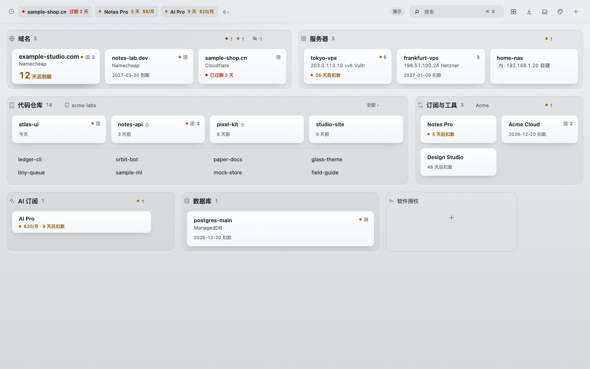
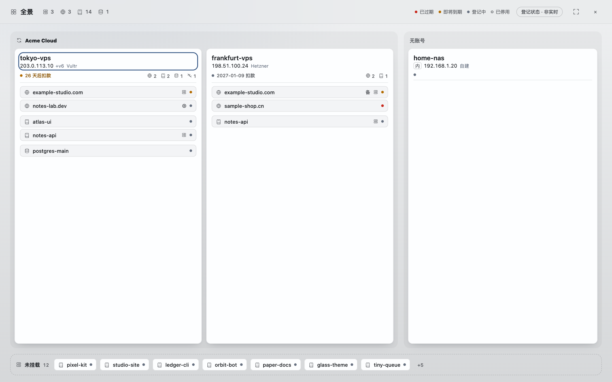

# Assetboard

*A local-first dashboard for your domains, VPS, repos and subscriptions. Native macOS app, nothing leaves your machine.*

<!-- {{PROMO_LINK}}: 推广链接位（发帖链接 / 主页），上线前替换或删掉这一行 -->
{{PROMO_LINK}}

面向个人开发者和小团队的本地数字资产总览：域名、VPS、代码仓库、订阅，放在一块板上，什么时候到期、哪天扣款，一眼看到。





## 亮点

- **数据只留本机。** 资产存在本地 SQLite，另有可读的 JSON 备份；没有账号、没有服务端、没有同步。
- **一屏大板。** 按类别分块，卡片上直接显示下次到期 / 扣款日期，快到期标黄、过期标红，顶部“接下来”条按日期排。
- **关联与全景。** 域名、仓库、服务和订阅账号可以挂在服务器上；按 `P` 进入全景，一屏看清每台 VPS 上挂着什么，拖动图块就能改关联。
- **多种导入。** 粘贴或拖入 CSV / JSON / 邮件，识别截图和 PDF，接 GitHub、Cloudflare，读 `~/.ssh/config`。导入先预览，确认才写入，整批可撤销。
- **键盘友好。** 搜索、导入、关联、全景、隐藏、置前都有单键快捷键，`?` 查看全部。

## 下载与安装

到 [Releases](https://github.com/hippone/assetboard/releases) 下载最新的 `Assetboard-macOS-arm64-*.zip`，解压后打开 `Assetboard.app`。

- 系统：macOS 12 或更高，仅提供 Apple Silicon（arm64）版本。
- 安装包已签名并公证，双击即可打开。
- 也可以不装，直接在浏览器里试：见下文“从源码构建”。

想先看看效果，用演示数据启动（不读也不写你的数据）：

```sh
open Assetboard.app --args --demo   # 在解压后的目录里执行
```

浏览器版在地址后面加 `?demo`。

## 快速上手

1. **放进资产。** 按 `I` 打开导入，拖入或粘贴文件；或者按 `N` 手动添加一项。每项可以记下次日期（到期 / 自动续费扣款 / 试用结束 / 取消截止，可按月或按年重复）、费用、账号、备注、管理链接。服务器可填最多 4 个 IP，卡片和详情里都能一键复制。
2. **挂关联。** 选中一张域名、仓库或订阅卡，按 `L` 选它挂在哪台服务器上。
3. **看全景。** 按 `P`，每台服务器一条泳道，下面挂着它的域名、仓库和账号，没挂上的单独放在“未挂载”。点一台进入聚焦，拖动图块可以改挂到另一台（按住 ⌥ 是同时挂两台，拖进“未挂载”是解除）。

## 导入方式

| 来源 | 说明 | 平台 |
|---|---|---|
| CSV / TSV / JSON | 拖入、粘贴或选文件；先预览再写入，一次最多 100 行，同名跳过，疑似密钥的列会丢弃 | App、浏览器 |
| 邮件（.eml） | 拖入后识别账单和续费信息，核对后新建或补充到已有资产 | App、浏览器 |
| 粘贴续费通知 | 本地规则识别商户、金额、周期和日期，核对后新建或补充到已有资产 | App、浏览器 |
| 截图 / PDF | 用 macOS 自带的文字识别在本机识别，进“待确认” | App |
| GitHub | 用本机已登录的 `gh`，或填只读的细粒度令牌（Metadata: Read），同步仓库名称、归属、可见性和归档状态 | App |
| Cloudflare | 只读 API 令牌，读取授权范围内的 Zone、Pages、Workers 和 R2 列表；权限不够的类别跳过 | App |
| `~/.ssh/config` | 只读 Host、HostName、User、Port，生成服务器 | App |
| Gmail | 自备 Google OAuth 桌面客户端，只读，搜索近 14 个月的账单和续费邮件。尚未用真实账号完整验证 | App |
| AI 识别（可选） | 接入你自己的模型（Claude、OpenAI 兼容接口或本机 Ollama），仅在你点“用 AI 识别”时发送。尚未用真实 API key 验证 | App |

导入结果都先预览，无冲突才直接写入，`⌘Z` 整批撤销。删掉的同步项再次导入会跳过。

## 快捷键

在输入框里打字时，字母键不生效。

| 键 | 作用 | 键 | 作用 |
|---|---|---|---|
| `⌘K` / `/` | 搜索 | `I` | 导入 |
| 方向键 | 移动焦点 | `N` | 新建 |
| `↩` | 打开详情 | `E` | 编辑 |
| `P` | 全景 | `H` | 隐藏 |
| `L` | 关联到服务器 | `F` | 置前 |
| `S` | 标记已停用 | `O` | 打开管理链接 |
| `⌥` + `←` `→` | 与相邻卡片交换 | `⌘C` | 复制 |
| `X` | 选两张交换 | `⌘Z` / `⇧⌘Z` | 撤销 / 重做 |
| `esc` | 返回 | `?` | 全部快捷键 |

## 从源码构建

需要 macOS 和 Xcode 命令行工具。

```sh
zsh desktop/build.sh     # 输出 dist/Assetboard.app（本机临时签名），并跑原生自检
node --test              # 单元测试
```

浏览器版不需要构建：

```sh
python3 -m http.server 4317 --bind 127.0.0.1
```

打开 <http://127.0.0.1:4317>，数据保存在当前浏览器的 localStorage，浏览器版没有 OCR、Gmail、AI 识别和钥匙串相关功能。

## 隐私与安全

- 不上传资产。数据只在本机；只有你主动触发导入或 AI 识别时才会联网，且只访问对应服务。
- 不探活。程序不会访问你的域名或 IP。全景里的状态是登记状态（到期情况加手动标记的“已停用”），不是实时状态。
- 令牌只读，存在 macOS 钥匙串；用本机 `gh` 时不另存令牌。AI 的 API key 同样存钥匙串。
- 全屏展示全景时，IP 默认遮住中间部分，悬停或按住 ⌥ 才显示。
- 演示模式用虚构数据，不读写你的数据。

## 常见问题

**数据存在哪？怎么备份？**
App 的数据在本机的 SQLite 文件里，菜单“文件 → 打开本地数据文件夹”可以直接打开；“文件 → 导出资产备份…”导出 JSON。没有云同步，换机器请用导出的备份。

**全景里的“运行状态”是实时的吗？**
不是。没有任何探测，只显示登记信息：是否到期，以及你手动标的“已停用”（`S`）。

**有 Windows / Linux / Intel Mac 版吗？**
没有，目前只发 Apple Silicon 的 macOS 版。浏览器版可以在任何系统用，功能少一些，见上文。

## 许可证

[MIT](LICENSE)

<!-- {{PROMO_LINK}}: 文末推广链接位，与顶部同一条，上线前替换或删掉 -->
{{PROMO_LINK}}
